[日本語](README.md)

# LWF Economy Graph

Look back at past runs of **Lazy Witch's Factory** from the office's `Business Log`. Also draws income and expense graphs into the Statistics screen

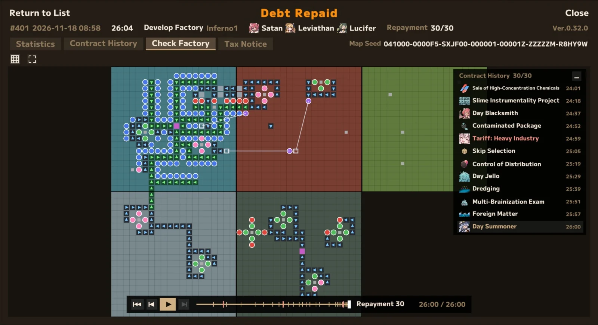

**[Download the latest release](https://github.com/KiyonakaNata/lwf-economy-graph/releases/latest)** / **[Thunderstore](https://thunderstore.io/c/lazy-witchs-factory/p/KiyonakaNata/LwfEconomyGraph/)** (one-click install with a mod manager)

---

## Business Log

- Opens from `Business Log` in the office
- A feature of this mod — the game's own `Business Log` is not implemented (as of ver 0.33.0)
- Set to stop working when the game implements its own

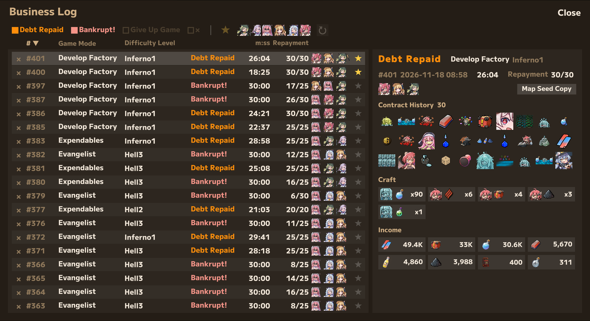

| List | Action |
|---|---|
| Row | Open that run |
| × on a row | Hide it (the × checkbox at the top lists hidden runs, + brings one back) |
| Star on a row | Star it |
| Star and sponsor faces at the top | Filter |
| Circular arrow | Clear the filters |

### Statistics

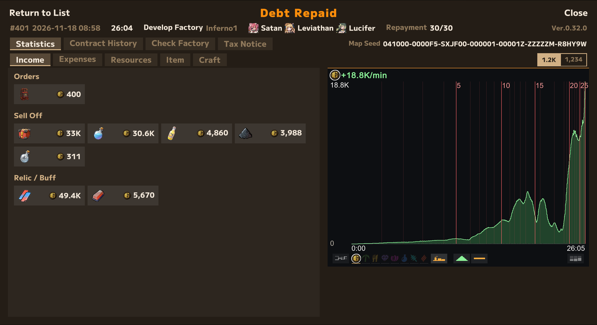

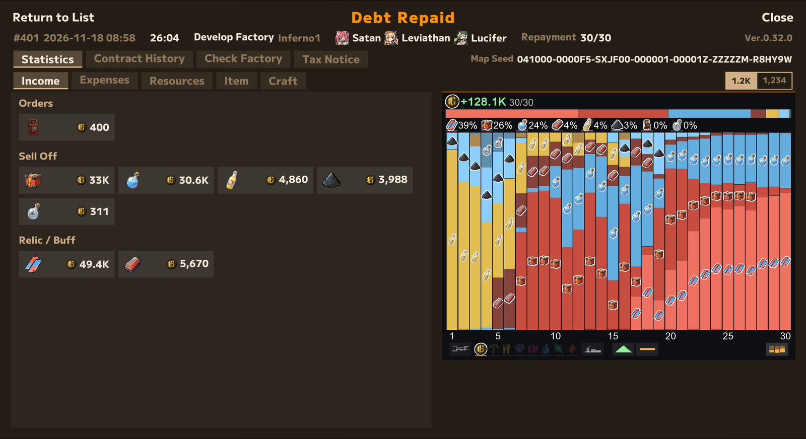

### Contract History

The button at the top left shows or hides the effect text

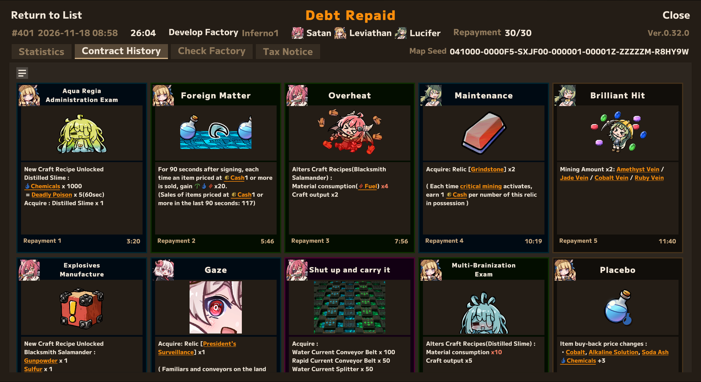

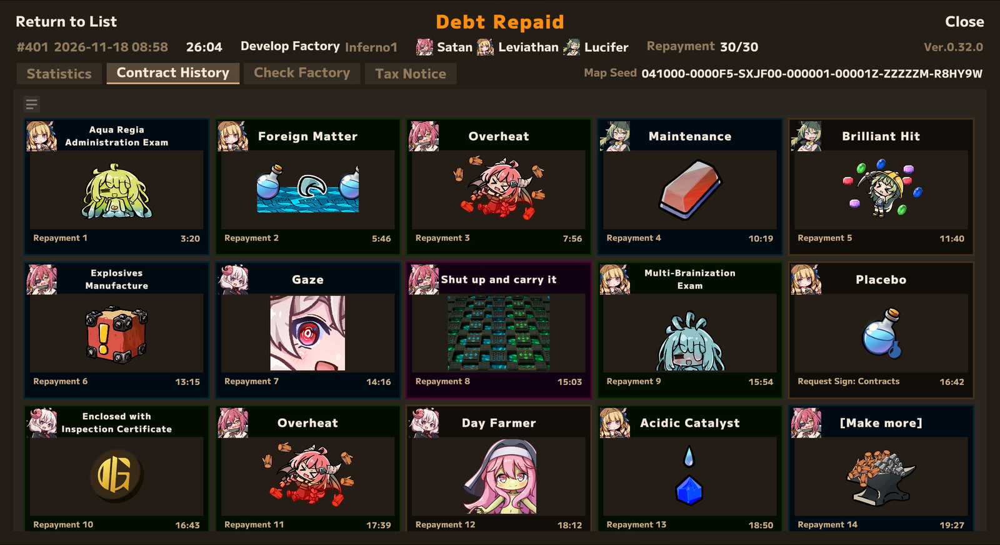

### Check Factory

The layout at each repayment and every 30 seconds

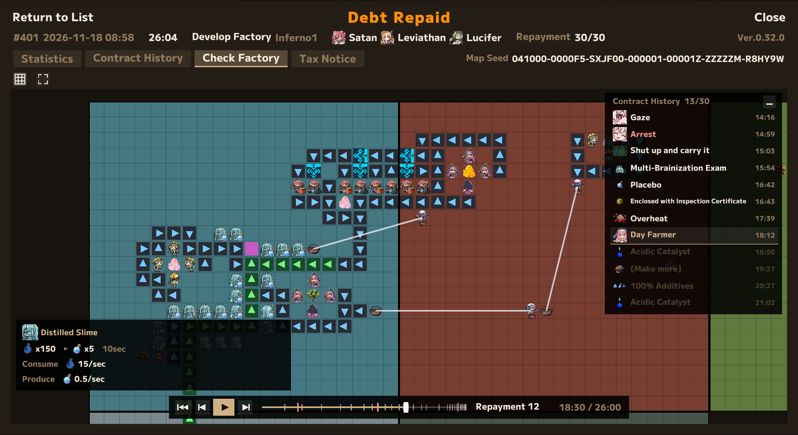

| Input | Action |
|---|---|
| A row of the Contract History at the top right | Go to where that contract was taken or that tax started |
| Mouse wheel | Zoom |
| Drag, movement keys | Move |
| Double-click | Zoom to the nearest land |
| Right double-click | Back to the whole map |
| ← → | Previous / next snapshot |
| Esc | Return to the list |

### Tax Notice

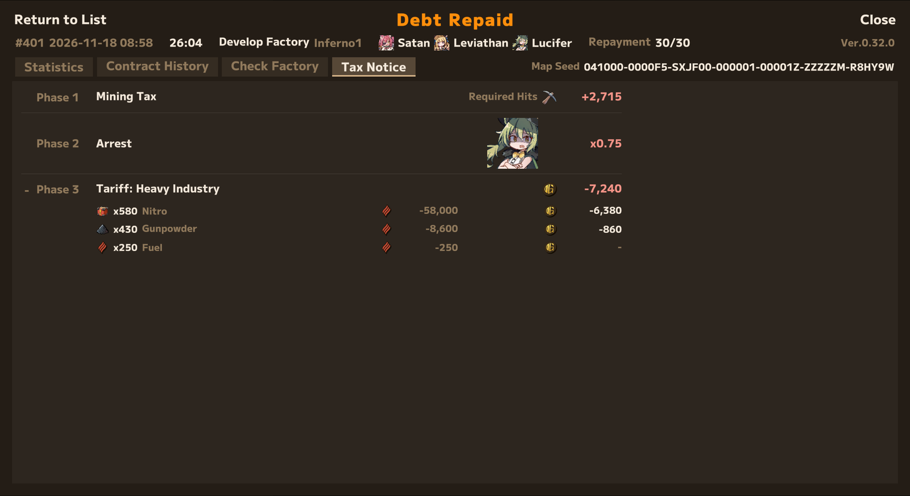

### What is recorded

- Location: `BepInEx/LwfEconomy/runs/`
- Only for runs played with this mod installed: the graph, the factory layout, the effect text, the tax breakdown, the map seed

---

## Graphs in the Statistics screen

Four views, switched from the toolbar under the graph

### Balance per repayment

- One bar per repayment
- Stacked by what paid for it
- Hover a bar for the breakdown of that repayment

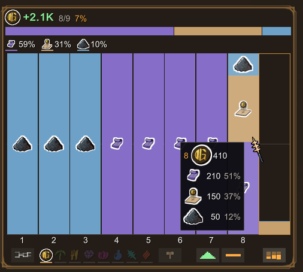

Resources work the same way, not just cash (left: income, right: expense)

  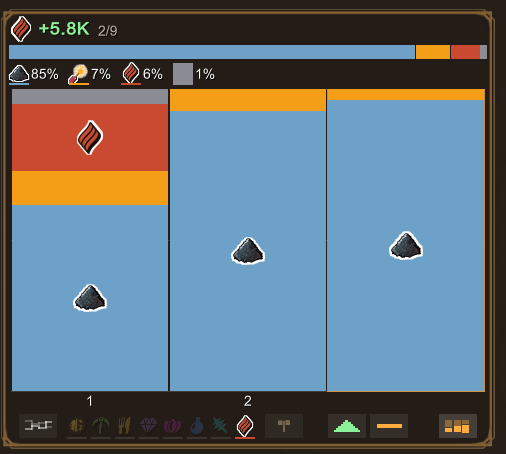
  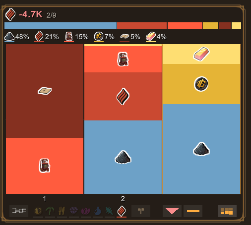

### Factory balance

- The per-minute change of each resource
- Counts **`Production` and `Sell Off` only**
- One-off changes (relics, wands, land purchases, penalties) are left out

  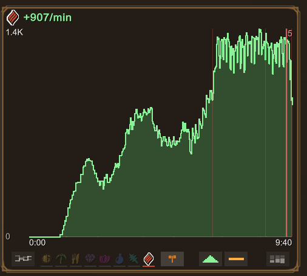
  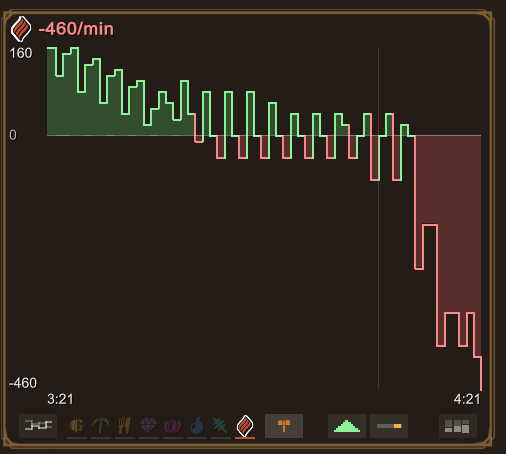

(left: nothing wrong / right: heading for a fuel shortage)

### Balance over time

- The stock of each resource
- A vertical line marks every repayment
- **Click the icon at the right end of a line to hide it**
  - The resource icons on the toolbar do the same, and bring hidden lines back

  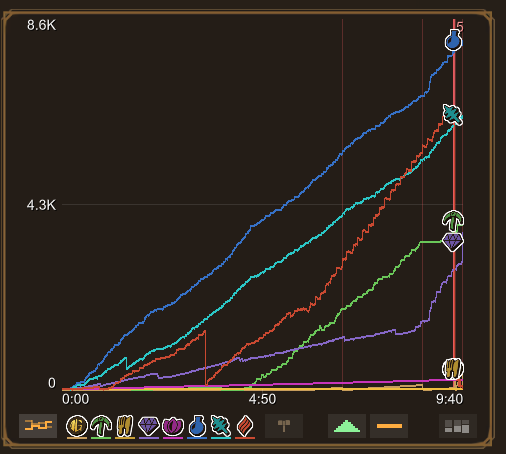
  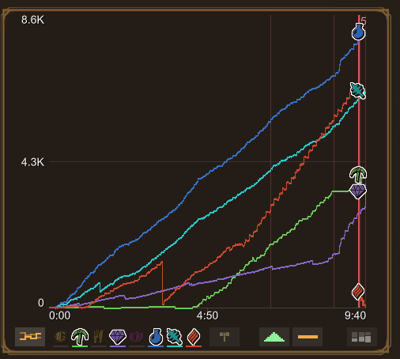

(left: all / right: some hidden)

### Rate

Set the range to `Past 1 Minute` for a rate chart

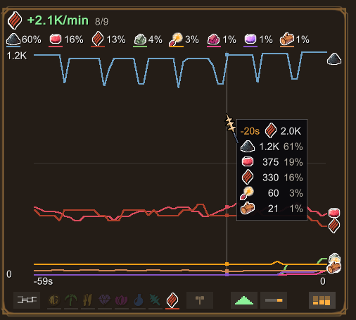

---

## Install (by hand)

1. Install **BepInEx 5** — [downloads](https://github.com/BepInEx/BepInEx/releases)
   - Get `BepInEx_win_x64_5.4.x.zip`
   - Extract it into the game folder (the one that holds `LazyWitchsFactory.exe`)

     > **Where the game folder is** (Steam)
     > Right-click the game in your library → Manage → Browse local files

2. Run the game once and quit, so that `BepInEx/plugins` and the rest are created
3. Take `LwfEconomyGraph.dll` out of this mod's zip and put it in **`BepInEx/plugins/`**
4. Start the game, open the Statistics screen, and check that the graph is there

## Uninstall

**This mod only**

- `BepInEx/plugins/LwfEconomyGraph.dll`
- To clear its settings and run records as well: `BepInEx/config/kiyonakanata.lwfeconomygraph.cfg` and `BepInEx/LwfEconomy/`

**BepInEx along with it** (every other mod stops too)

- The `BepInEx` folder
- `winhttp.dll`, `doorstop_config.ini` and `.doorstop_version` in the game folder

---

## Using the graphs

| Toolbar button | What it does |
|---|---|
| Overlaid lines | All 8 resource balances at once |
| Resource icon | Look at that resource (while overlaid: show / hide it) |
| Hammer | Factory balance of the selected resource |
| Triangle | Income ↔ Expenses |
| Bar | Whole Game ↔ Past 1 Minute |
| Stack | Breakdown per repayment |

The toolbar and the game's own Statistics tabs stay in sync

---

## Settings

`BepInEx/config/kiyonakanata.lwfeconomygraph.cfg` (created once the game has run)

| Key | Default | Values |
|---|---|---|
| `Enabled` | `true` | `false` stops both recording and drawing |
| `EmbedInStatsWindow` | `true` | `false` draws no graph in the Statistics screen |
| `StartMode` | `0` | 0 = factory balance / 1 = balance over time / 2 = balance per repayment |
| `FontName` | empty | Set this only if text renders as □ (e.g. `Yu Gothic UI`) |
| `IconOutlineWidth` | `0.05` | Width of the white outline on icons (`0` for none) |
| `[BusinessLog] Enabled` | `true` | `false` turns the Business Log off and keeps no run records |

---

## Requirements

| | |
|---|---|
| Lazy Witch's Factory | Tested on **ver 0.33.0** |
| BepInEx | checked with **5.4.23.5** (any 5.4.x should do) |

If a game update stops it from working, that is the end of this mod's life — remove it

## When it doesn't work

Look at `BepInEx/LogOutput.log` first

| Log | Where you stand |
|---|---|
| no `[boot] LWF Economy Graph ...` line | **Not loaded** — check where the DLL ended up |
| `[stats] ... not found` | **The graph works** — the toolbar won't stay in sync with the game's window |
| `[hook] ... land purchases ...` | **The graph works** — land purchases land under "Other" |
| `[hook] ... Land Swindler ...` | **The graph works** — Land Swindler income lands under "Pact" |
| `[hook] ... wand rewards ...` | **The graph works** — Liquid Solution and Fireball income land under "Other" |
| `[log] ButtonArchives not found` | **The graph works** — the Business Log does not open |
| `[log] the game's own ButtonArchives is usable ...` | **The graph works** — the Business Log opens the game's own screen |
| `[map] cannot capture the factory ...` | **The Business Log works** — `Check Factory` is missing |
| `[tax] cannot record the taxes ...` | **The Business Log works** — the Tax Notice lists tax names only |
| `[stop] ... the mod is now off` | **The mod stopped itself** — restart the game |

**A bug report** needs these two

- a screenshot
- `BepInEx/LogOutput.log`

---

## Disclaimer

- **Unofficial mod** — not supported by the developer
- Bugs, crashes and broken saves with the mod installed are at your own risk
- Built in line with the [official stance on mods](https://store.steampowered.com/news/app/3971650/view/699897618302503133) (Japanese)

The source is MIT licensed. The screenshots under `img/` are captures of the game and belong to its developer
