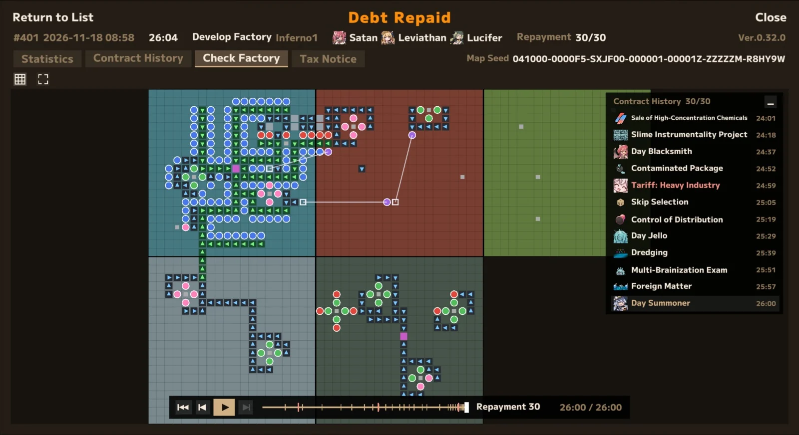
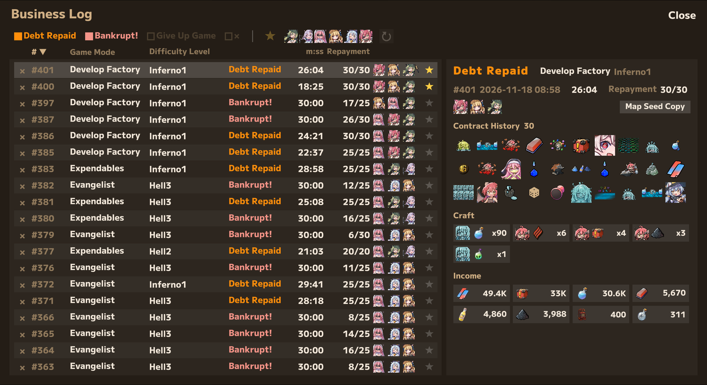
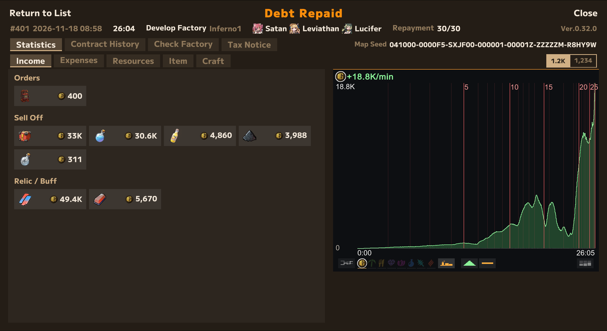
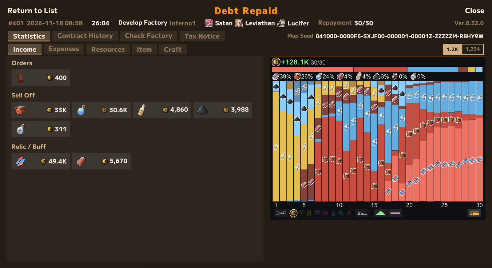
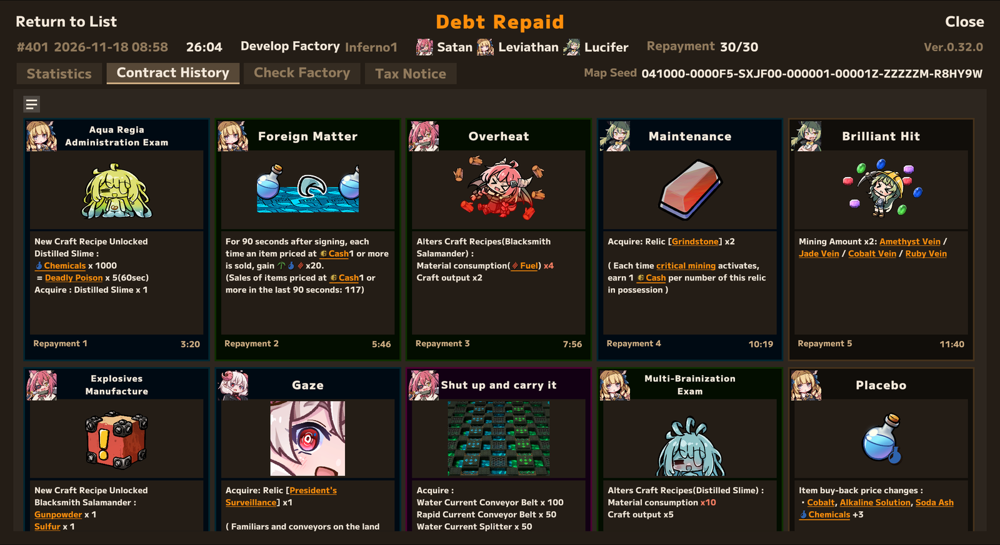
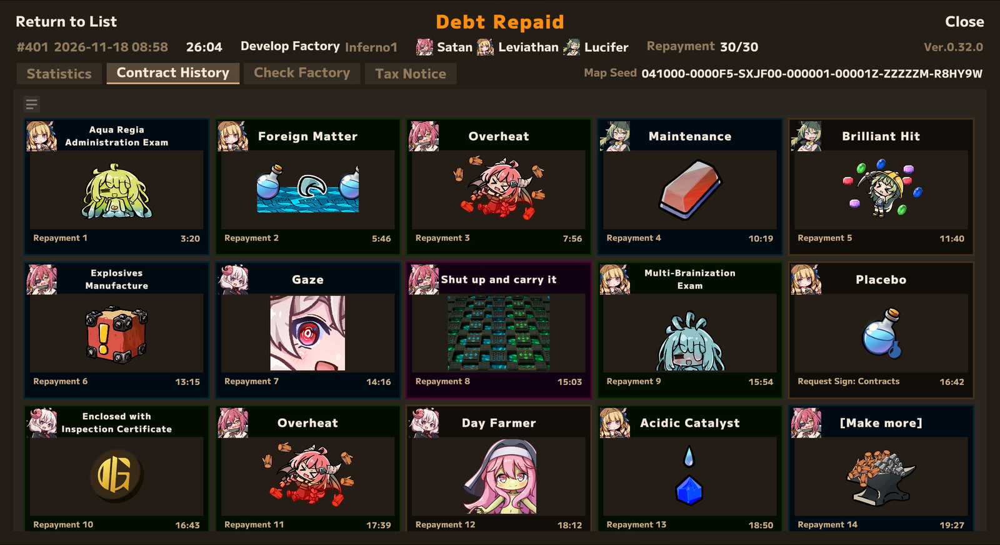
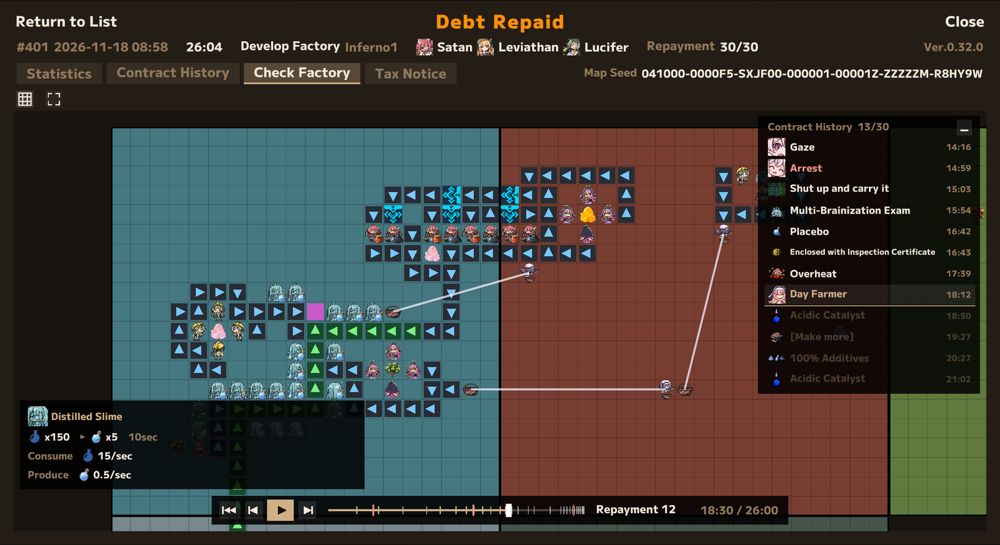
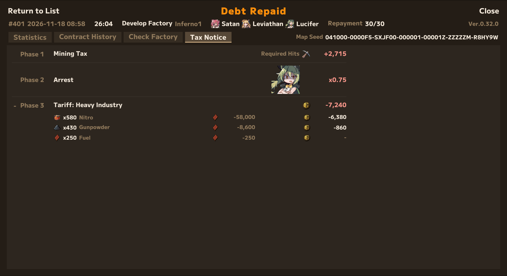
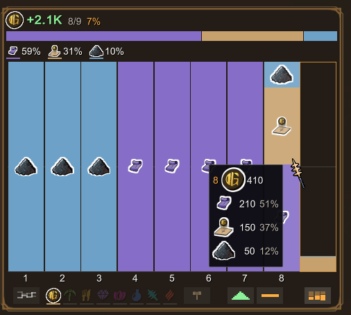

# LWF Economy Graph

- Look back at past runs of **Lazy Witch's Factory** from the office's `Business Log`
- Draws income and expense graphs into the Statistics screen

## Business Log

- A feature of this mod — the game's own `Business Log` is not implemented (as of ver 0.33.0)
- Set to stop working when the game implements its own

### Statistics

### Contract History

### Check Factory

- The factory layout at each repayment and every 30 seconds, with playback
- Click a row of the Contract History → go to where that contract was taken or that tax started

### Tax Notice

## Graphs in the Statistics screen

- Four views, switched from the toolbar under the graph
- **Balance per repayment** — one bar per repayment, stacked by what paid for it
- **Factory balance** — the per-minute change of a resource, counting `Production` and `Sell Off` only
- **Balance over time** — the stock of each resource, with a vertical line at every repayment
- **Rate** — set the range to `Past 1 Minute`
- Hover a bar → the breakdown of that repayment
- Click the icon at the right end of a line → hide that line

## Notes

- Run records are kept in `BepInEx/LwfEconomy/runs/`
- The graph, the factory layout, the effect text, the tax breakdown and the map seed appear only for runs played with this mod installed
- If text shows as □, set `FontName` (e.g. `Yu Gothic UI`) in `BepInEx/config/kiyonakanata.lwfeconomygraph.cfg`
- Controls, settings and troubleshooting: [GitHub](https://github.com/KiyonakaNata/lwf-economy-graph/blob/main/README.en.md)
